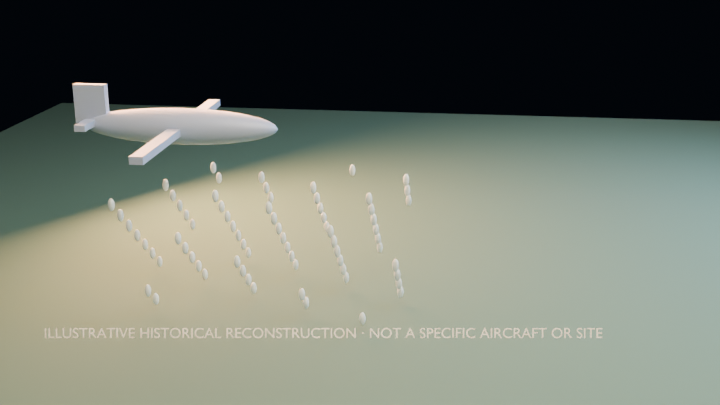
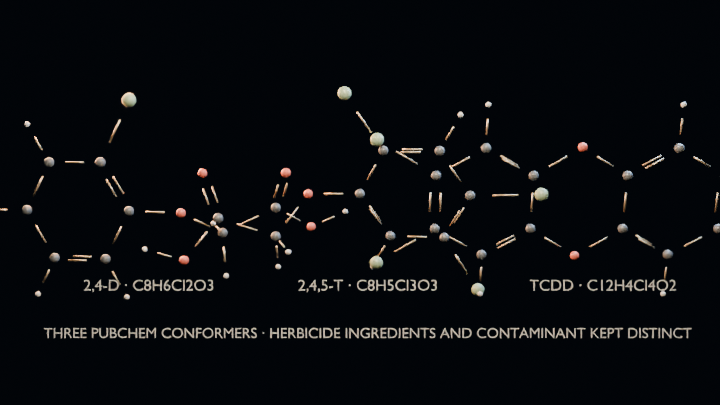
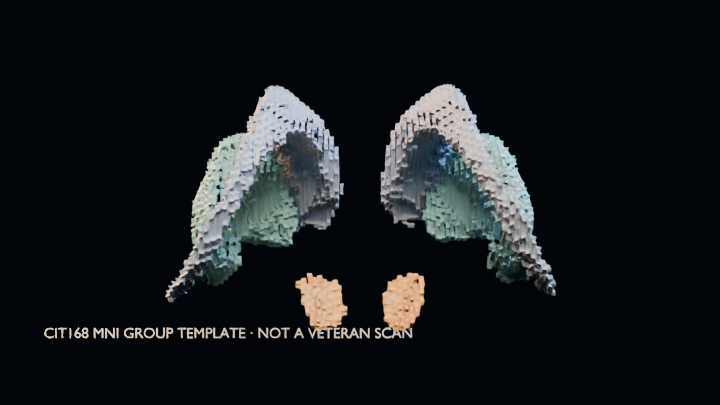
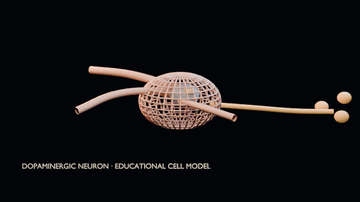
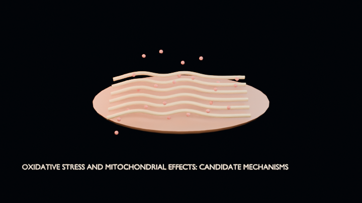
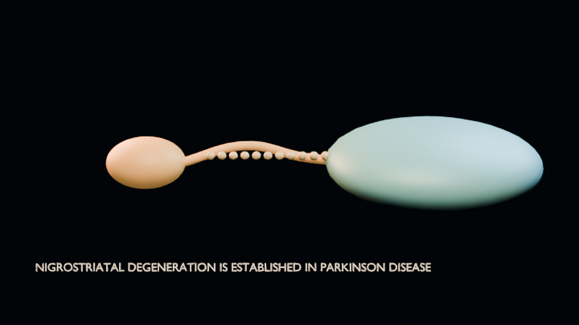
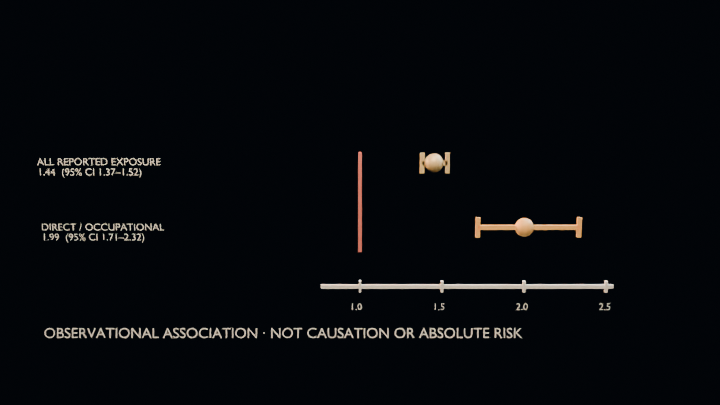

# Film frame review

Eight representative Cycles renders from the seven-shot Blender scene. These are review frames, not the final encoded film.

| Timeline beat | Rendered frame |
| --- | --- |
| Historical exposure · 00:00 |  |
| Chemical identity · 00:15 |  |
| Atlas structures · 00:30 |  |
| Neuron · 00:45 |  |
| Candidate mechanism · 01:00 |  |
| Nigrostriatal context · 01:15 |  |
| Cohort estimates · 01:30 |  |
| Closing · 01:45 |  |

The chemical shot was revised after contact-frame inspection: molecule groups were spaced apart, per-molecule labels moved to a separate caption line, and the general caption shortened to remove collisions. The estimates shot names both exposure groups and shows hazard-ratio ticks. The closing chart is held as a deliberate evidence pause. These previews still need comparison against the encoded film.
