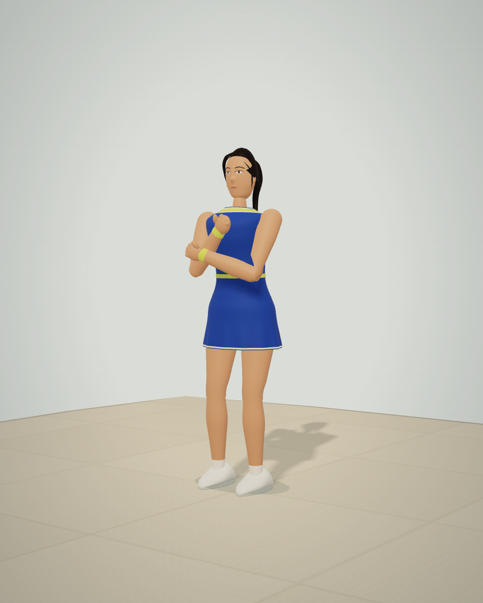
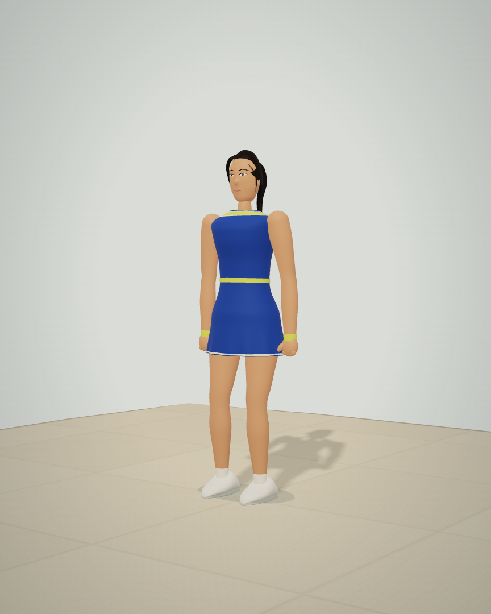
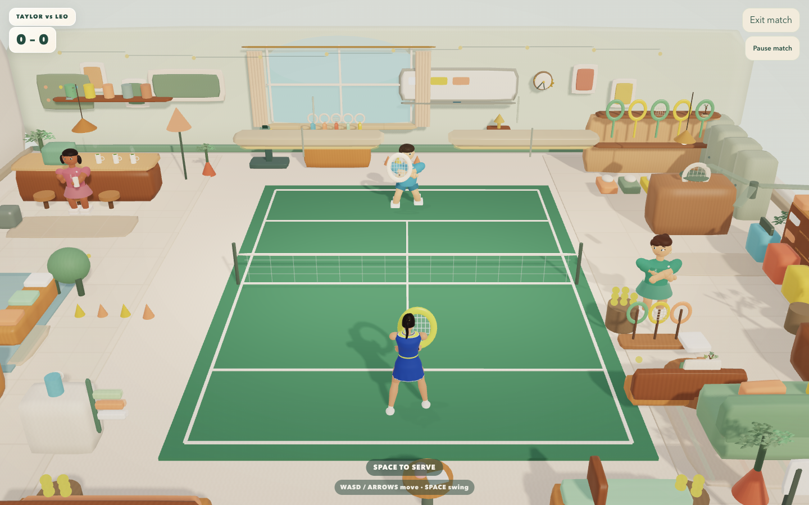
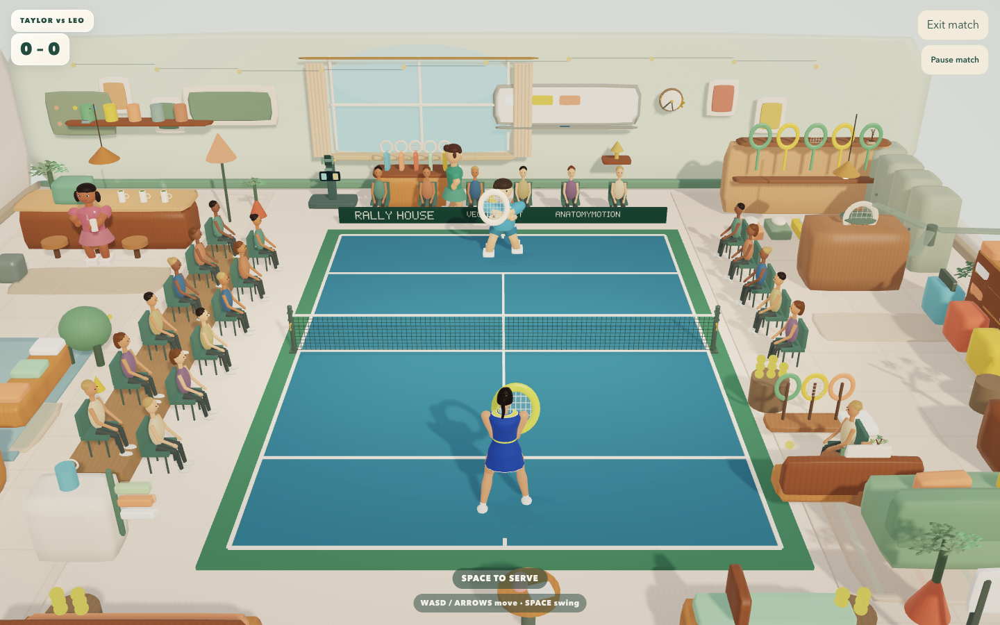

# Human arm mechanics and Championship detail

The human avatar was still inheriting the feline folded-arm stance. Compact serve targets could also place a full-length adult hand nearly on its shoulder, while the short contact window could produce an abrupt backhand crouch. Taylor now rests with her hands on their own sides, uses body-relative elbow poles, retains a minimum free-hand reach, and anticipates contact with a broader body-load window. Exact contact hands continue to own the racket. Her approved human face and tennis outfit remain intact.

## Actual before and after

The arm images use actual character meshes and the production renderer on an authored inspection stage; they are **not gameplay screenshots**. The baseline runtime is the merged human-avatar build at `388f3f0` (same runtime as `310d307`).

| Before | Corrected human rest pose |
| --- | --- |
|  |  |

These court images come from actual Championship play in a native browser. Entry uses the real challenge lifecycle; a real Space-key serve, opponent return and missed player return produce the scored point. No substitute ball animation or fabricated point drives the gallery.

| Before Championship | Detailed Championship |
| --- | --- |
|  |  |

The [unedited native browser recording](match/championship-live.webm) includes entry, serve, point reaction, portrait layout and exit. See the [actual point](match/point.webp), [portrait match](match/portrait.webp), [moving registered replay](motion/registered-motion.webm), and [portrait phone review](phone/review-body.webp). [Image hashes](image-manifest.json) preserve source PNG and lossless WebP SHA-256 values; no resize or other edits are applied. Raw captures and early iterations remain local. Private photographic references are not published.

## Authored court detail

The permanent court now has a woven charcoal net, bound top tape, center strap, lower cable, capped posts, anchor bolts and tension cranks. Four cached material batches replace many separate strands. The visible top tape ends at the actual `.94`-unit collision plane.

Championship adds blue playing-surface dressing, 24 seated guests, a raised west tier and a branded backboard for Rally House, VectorCourt and AnatomyMotion. Seats leave the playable court and existing equipment displays clear. Ceiling pendants use the lab's established camera-cutaway treatment so they cannot cover the far player or gallery. Point events drive bounded applause, with staggered groups; reduced motion keeps the seated rest pose. Returning to the club removes the gallery and court dressing. Ball physics, scoring, input forgiveness, reservations and saves retain their existing owners.

The gallery uses **29 render batches**, including eight arm batches, rather than one draw per small feature. Net and gallery together contain **49,656 triangles**. Geometry and reaction state are bounded; static net geometry is built once per runtime. This is a detailed stylized club tournament, not a claim of photographic or AAA asset fidelity.

## Verification

- **30 game suites pass**: [game-tests.log](game-tests.log). The final visual platform-height polish was followed by the focused gallery suite and release verification.
- The independent [before/after anatomy audit](anatomy-audit.json) inspects the same 4,200 motion frames at 30/60/120 Hz. Old/new rest failures are **24/0**, and maximum sampled elbow flexion changes from **174.76° to 153.89°**. The new suite also checks same-side wrists, descending rest chains, bounded flexion and elbow continuity at four body headings. These are game-geometry checks, not clinical validation.
- Adult tests inspect **43,128 limb lengths**, maximum stretch `1.0000000000000013`, and maximum tested contact error `1.92e-16` club units. **7,560 skin-surface joint checks** have maximum error `4.19e-7`. Continuous reconstruction covers **3,800 intermediate poses**, maximum joint-registration error `5.17e-7`.
- Chromium, Firefox and WebKit pass native human selection, desktop/portrait views, actual Championship contact, exit and saved-avatar reload, with no runtime or HTTP errors: [Chromium](chromium/report.json), [Firefox](firefox/report.json), [WebKit](webkit/report.json).
- [The real keyboard-play report](match/report.json) confirms a scored point changes the actual gallery arm transforms, reduced motion supplies static poses, and club restoration leaves zero gallery meshes. The observed recorded serve ball/string-center gap is approximately `0.0347` club units.
- Moving replay passes **540 actual RAF frames** with zero joint-node disagreement and fractional canvas picking: [motion/report.json](motion/report.json).
- Final portrait phone capture has **153 pose samples**, an encoded video, **13.602 ms** observed video/replay discrepancy, exact paused seek, exact mounted-hand ownership, full-body visibility, zero Axe violations, no overflow/runtime/HTTP errors and stream cleanup: [phone/report.json](phone/report.json).
- Portfolio verification passes **91 tests**, TypeScript, the **32-route build**, and lint with **0 errors / 12 retained warnings**: [portfolio-verify.log](portfolio-verify.log). [Portfolio entry](portfolio-entry.json) loads and retains the owner labels.
- All **74 source/served artifacts** match. The **76-file standalone** passes CRC and exact source bytes: [package.json](package.json). Five fresh browser contexts start without runtime or network errors: [standalone-diagnostic.json](standalone-diagnostic.json).

One exploratory full run was interrupted to cache the static net across repeated world construction; its partial [log](game-tests-interrupted.log) is retained, followed by the complete passing run. An initial phone QA hand comparison failed after a fixed 850 ms wait and screenshot; that check did not record the phase. The [original partial report and failure](phone-first-attempt/failure.json) remain. The check now observes the actual mounting phase and retains its report before asserting; the full repeat passes with zero hand error.

These local checks do not establish universal frame rates or physical-phone performance. Phone capture records the simulated scene and known avatar motion; it does not activate a device camera or run CV, force estimation or clinical analysis.

## Reproduction

Run `npm test` and `npm run release:check` from `rally-house-source-v16`, with source served on 8078 using `node qa/serve.mjs`. Run `QA_ENGINE=chromium QA_OUT=evidence/new-arm-check/chromium node qa/taylor-human.mjs`, then repeat for Firefox/WebKit. Run `QA_OUT=evidence/new-arm-check/match node qa/championship-detail.mjs` for real keyboard play and video; `QA_AVATAR=Taylor QA_WIDTH=390 QA_OUT=evidence/new-arm-check/phone node qa/phone-capture.mjs`; and `QA_OUT=evidence/new-arm-check/motion node qa/replay-smoothness.mjs`.

Export the complete `rally-house-source-v16/dist` tree from `388f3f0` to an immutable directory. Supply that directory through `QA_BASELINE_RUNTIME` to `qa/anatomy-audit.mjs` and `qa/championship-detail.mjs` for the baseline comparisons. For isolated arm renders, run `QA_REFERENCE=0 QA_OUT=evidence/new-arm-check QA_LABEL=arms node qa/taylor-proportions.mjs`. Run `npm run verify` in `arjan-portfolio`. Package with `python3 qa/package-playtest.py`, serve the extracted runtime on 8079 with the packaged launcher's connection backlog, then run `QA_OUT=evidence/new-arm-check node qa/standalone-diagnostic.mjs`.
