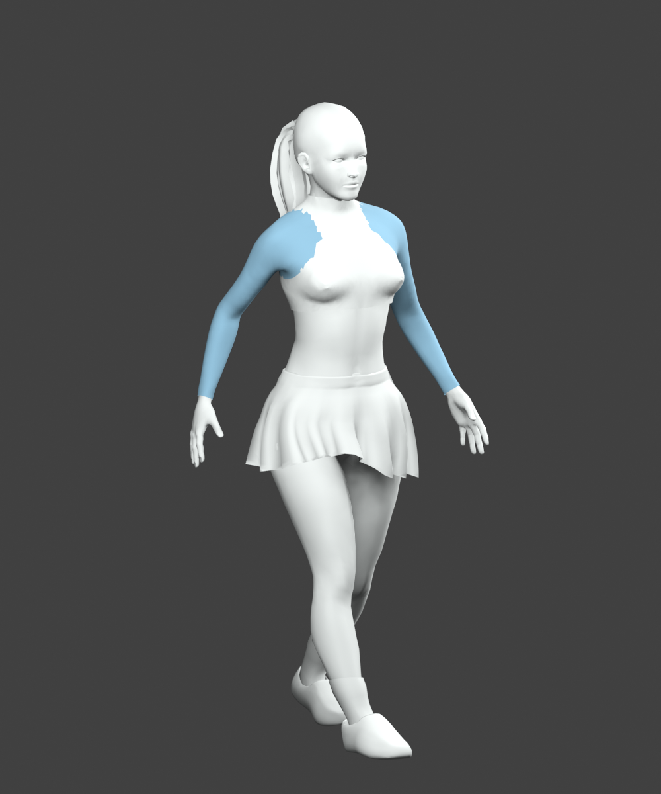
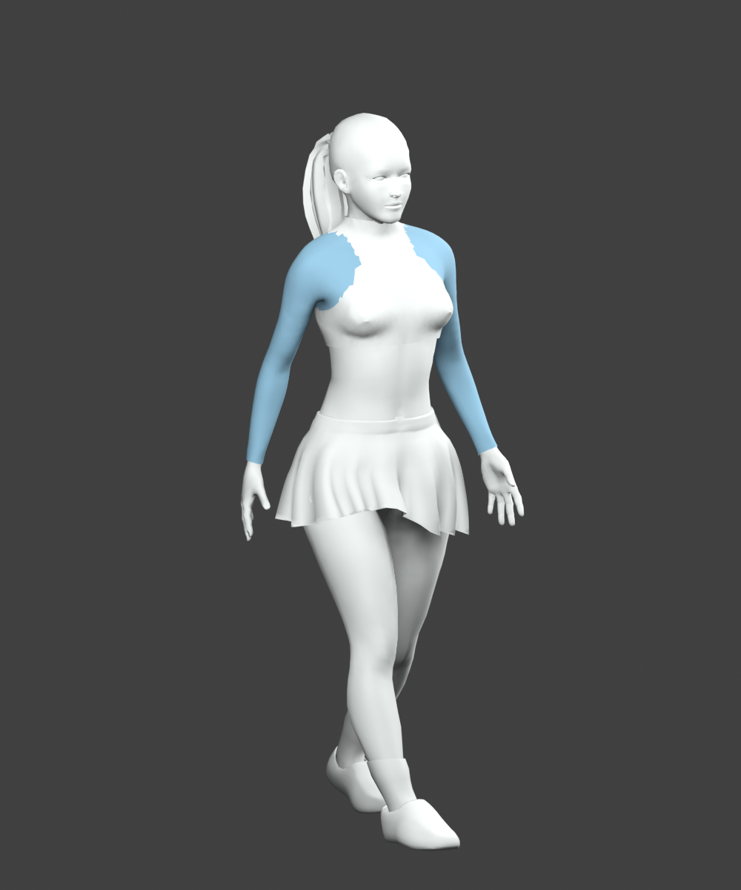

# Athletic walk correction

The user reported a chicken-like walk. The shared walk solver held elbows at a fixed bend, spread hands wide around the skirt and let the airborne leg pull the body downward. Walking now uses planted-foot support, recovers an overreaching airborne shoe horizontally, and keeps a softer changing elbow bend with narrower hand clearance. The foot arc, travel speed, cadence and settled hands-on-hips pose are preserved.

The user refreshed the local game, walked across the club and reported **“More natural and athletic.”** Gait, authored character/contact, arm anatomy, walking routes, recording, replay and release-mirror checks pass. The stronger loaded-walk regression fails on the previous runtime. The settled hands-on-hips landmarks and skin palettes match exactly.

| Before | After |
| --- | --- |
|  |  |

These are matched **offline CPU-skinned geometry views**, not game screenshots. Materials are simplified and sleeve-weight regions are blue; textures, runtime lighting and GPU skirt correction are omitted. They show the narrower arm carriage at the same walk time, not complete runtime motion quality.

Rejected: recovering an airborne shoe by normalizing its full 3D reach raised it above the intended foot arc; horizontal recovery preserves the authored clearance. No change to the resting hip pose or stroke targets. Existing loaded backhand/serve sleeve intersections remain. No fresh device performance measurement.
