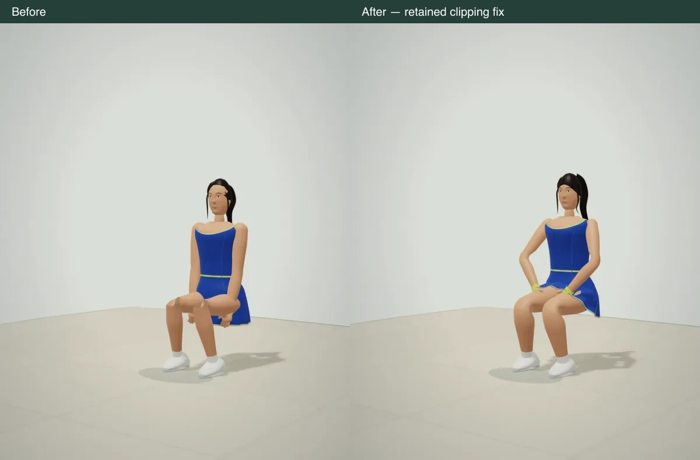

# Character clearance pass — 20 October 2026

Appearance verdict: **not accepted; not cold-send ready.** The human review still found the characters toy-like after an anatomical head replacement. A complete textured cartoon character and a natural skin material were also evaluated locally and rejected. Those experiments and their renderer changes are absent from this build.

## Running-game delta

1. **Wrong:** forearms passed through the torso; seated thighs inverted, knees hollowed, hands fell below the lap, and the skirt cut through the legs. The hairline intersected the face.
2. **Cause:** one posterior arm pole for forward reaches; a forward-vector skin frame became singular at horizontal thighs; joint rings bent wholly onto the child bone; a pelvis-only garment; standing hand targets while seated; an independently sized scalp.
3. **Retained fix:** body-aware arm goals, a stable lateral frame for legs, shared joint weights, thigh support for the front hem with the back draping from the pelvis, continuous seat transitions/lap hands, fitted scalp clearance, and the existing limb geometry with a slimmer arm profile for women. Contact goals, renderer, save format, and animation ownership stay on their existing paths.
4. **Regression:** full `npm test` passed before the final hem refinement; the affected geometry, tailoring, anatomy/contact and clearance suites passed after it. Native desktop/touch entry reached a three-shot rally in 6.72/6.11 seconds. Selection and recorded racket contact passed; anchored-phone recording/replay preserved the world, synchronized within 12 ms, and had no Axe violations. Matched native ABBA rendering held a 16.7 ms median before/after in the same paused club; this does not measure active simulation FPS. The final source/mirror release check passed for all 92 artifacts.
5. **Perception:** seated knees retain their volume, hands sit above the thighs, the hem follows the lap, and ordinary arms no longer cut through the torso. The face, hair, clothing and overall appeal still miss the supplied references. Some fabric contact at hands/hips remains; this is not cloth simulation.
6. **Colleague-send test:** closer on embodiment and clipping, **still no** on the overall game because character appeal failed human review.

These are production `Character.meshes` and `Renderer` on an isolated diagnostic stage, not a separate model renderer or live chair interaction. Review images are resized/re-encoded from native DPR2 captures; pose, camera and lighting match. `native-views.json` records the full 12-view inspection, including tennis poses. No private reference photographs are included.

## Exact remaining authored input

One finished, clothed adult female tennis character approved against the supplied references: athletic proportions, a finished face, brows/eyelashes, an authored ponytail silhouette, a fitted blue/yellow tennis outfit, hands and court shoes. Start with Taylor; approval of this one character must precede replicating the cast.

Deliver an uncompressed glTF 2.0/GLB, no more than 40,000 triangles, named skin/hair/clothing material slots, position/normal/UV attributes, 2K base-color/normal/roughness maps, and a single skin fitted to the existing 15 named joints in `src/animation/CharacterSkin.ts`. Supply the bone map, inverse bind matrices, and at most four normalized influences per vertex. Include sculpted neutral/smile and open/closed eyelid shapes or separable facial pieces that can follow the existing expression controls; no replacement gameplay animation system is needed.

It plugs into `CharacterAssetIntake` for provenance/geometry inspection and `Character.meshes` for rendering, retaining the current landmark pose/contact solver. The current inspector deliberately rejects textured assets: its UV/material adapter must be completed when the approved asset is integrated. A local albedo prototype rendered successfully, but was removed with the rejected art. Neither intake nor material support should be represented as already production-complete.

The existing ring/patch geometry and generic candidate meshes can improve deformation, but have not produced the requested beauty, groom or coherent garment design. The measured contact/gait work is not the limiting input. A character artist's finished sculpt, wardrobe/groom and human visual approval are the specific remaining requirement.
