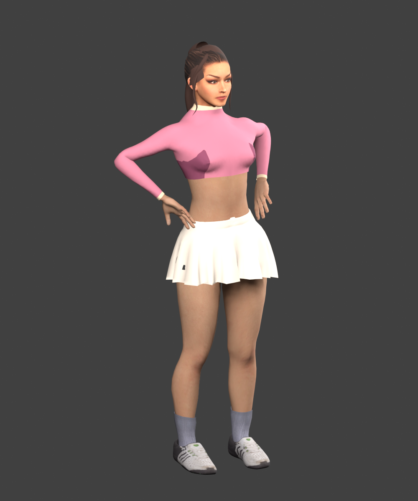
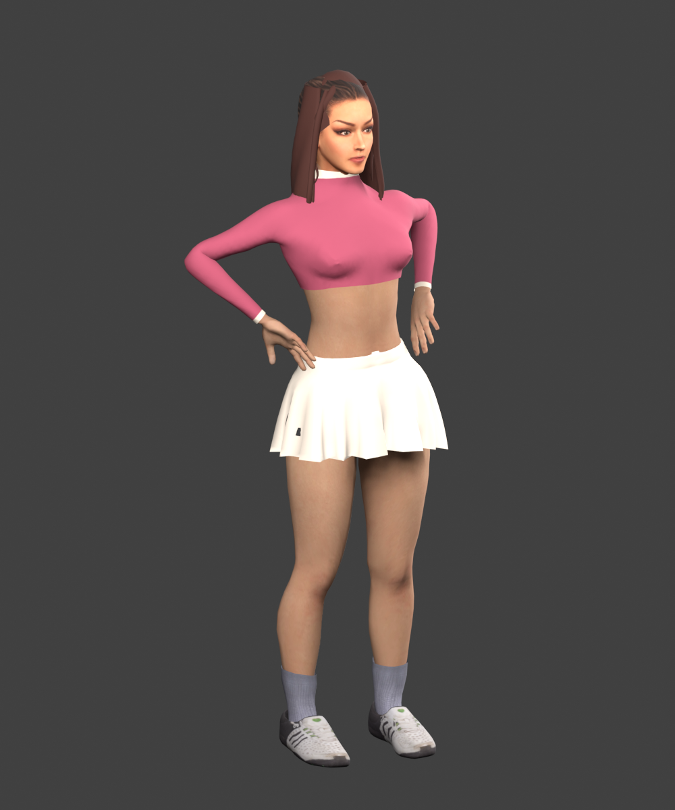
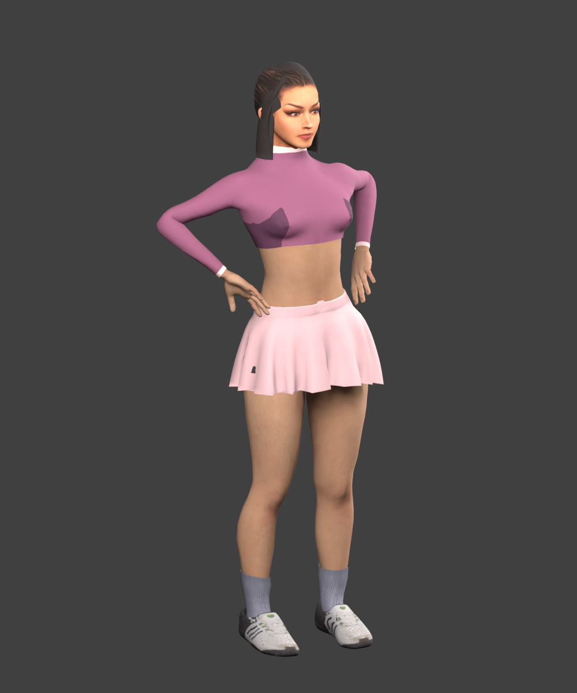
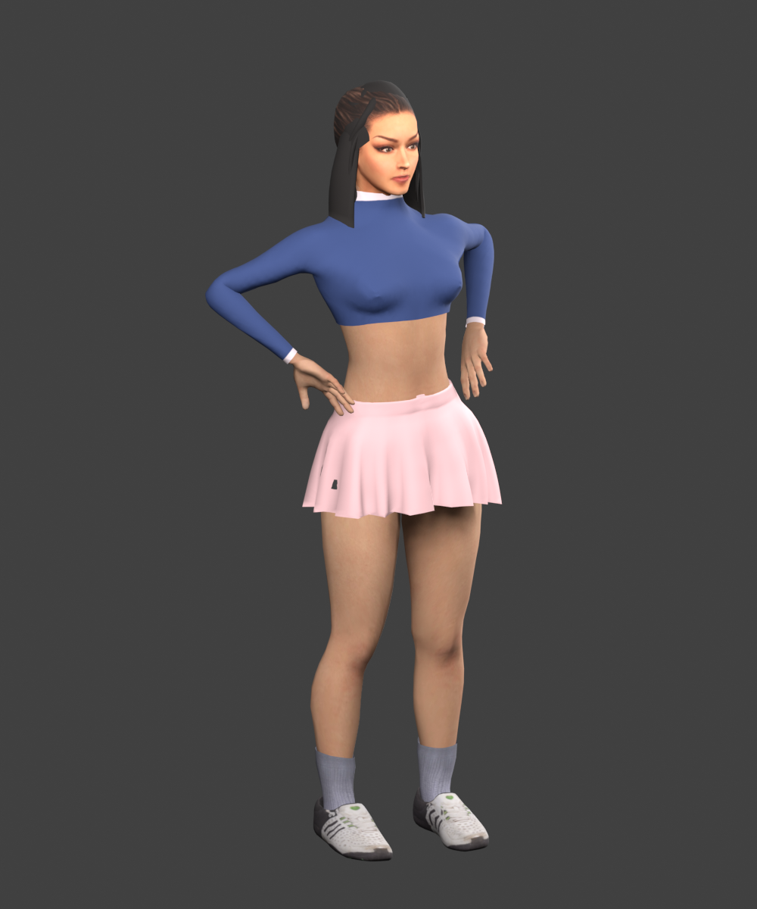

# Court sound and cast candidate

Player footsteps were never consumed by the game’s audio path, and other shoes used a faint generic tick. Every actor’s landing event now reaches a cached court/tile material sound in the same simulation frame, with short rubber scuffs and quieter background actors. The user confirmed that the footsteps work.

The first opponent reaction used device speech and excluded clean winners. The user heard no voice and saw no caption. A lost opponent point now qualifies, including a missed return of a winner; a cooldown and sparse cadence limit repetition. Bundled recorded voices replace device speech, with captions attached to the opponent. Mute, pause, return and late-load cancellation share audio ownership. Audio credits and preparation ranges are in assets/audio/.

The other adult women have a softer jaw silhouette, fuller hairstyles and a restrained torso/hip fit shared by body and garments. The kit palette bake removes misplaced dark underarm panels and keeps registered collar/cuff trims. Walking, hip-rest targets, rig and contact ownership are unchanged; palette and pose checks pass.

| Character | Before | After |
| --- | --- | --- |
| Lucresia |  |  |
| Barbara |  |  |

These are **offline textured CPU-skinned comparisons, not game screenshots**. Camera and lighting match. They omit runtime lighting, GPU skirt projection and non-skinned accessories. Final recorded voice and cast appeal still await human runtime confirmation.

Rejected: device speech as the sole voice path; a flat long-hair shell without rounded locks; hair tessellation that exceeded the existing head budget; thick tubular front locks, replaced with thinner tapered strands. No TV dialogue or actor imitation is used. The masculine source recording retains saturation; loaded stroke sleeve intersections remain. No fresh device frame-time claim.
