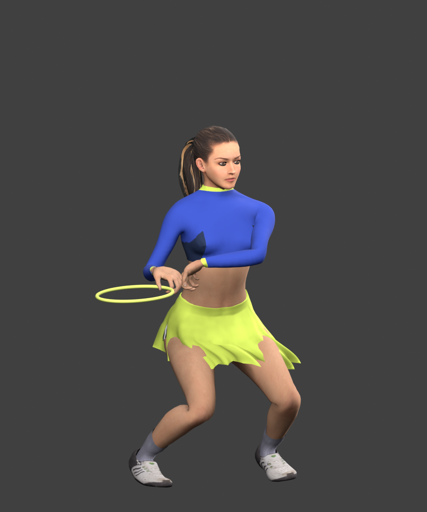
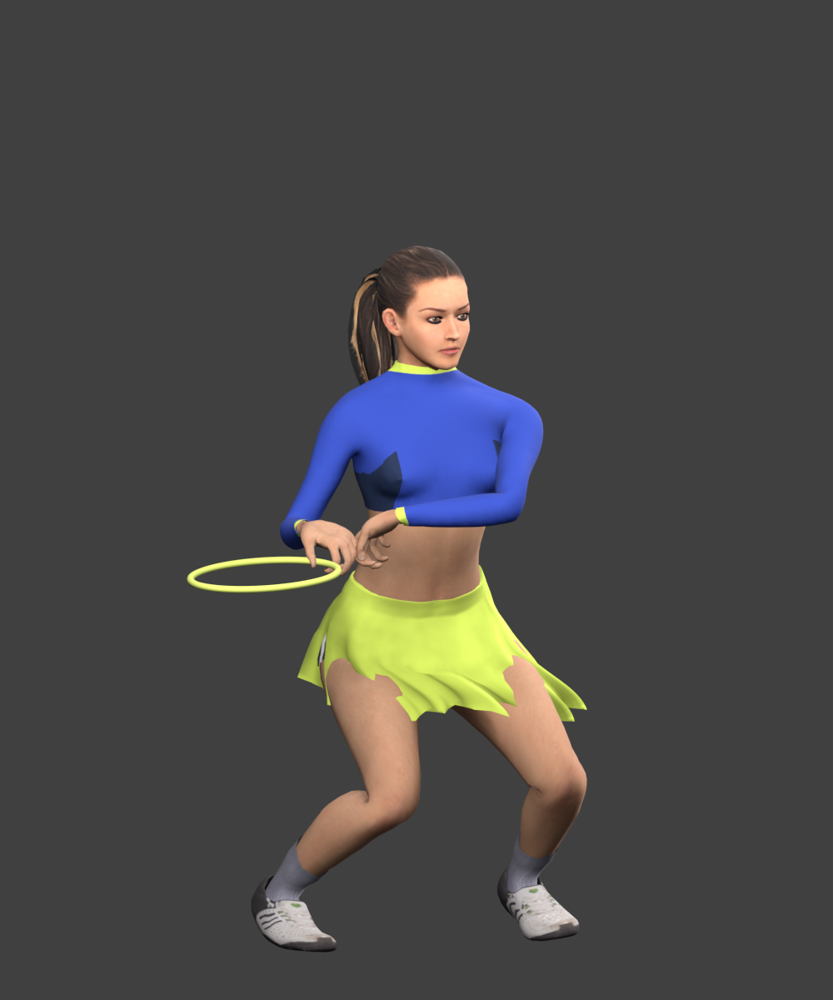

# Cross-body shoulder reach candidate

The fitted sleeve still entered the chest during backhand preparation and serve recovery. The shoulder advanced too little as the arm crossed the body. The shared human stroke solve now allows a modest additional shoulder-blade reach while the sternum retains its anchor. The change is one solver coefficient; grip authority, arm lengths and the existing motion layers remain.

The offline comparison shows a reduced sleeve/chest merge with a small silhouette change. The sampled backhand penetration falls from roughly .039/.050 to .013/.022 game-world units at .10/.20 seconds; serve recovery falls from .075 to .061. These ray depths are approximate and residual intersections remain. Final runtime visual acceptance is pending.

| Before | Candidate |
| --- | --- |
|  |  |

These are matched offline textured CPU-skinned renders, not game screenshots. They omit runtime lighting, GPU skirt projection and rigid racket strings/shaft. The after render uses the same compiled solver as the running candidate.

The expanded jersey check retains the zero-intersection ready/forehand gates and adds explicit geometric penetration bounds for backhand preparation and serve recovery across the four women at 30/60/120 Hz. It fails on the preceding runtime and passes on the candidate. Authored body/contact, arm anatomy, garment creasing, gait, stroke footwork, recording/replay and source/public release parity checks pass. Walking, hands-on-hips and the accepted stroke-foot positions exactly match the preceding runtime in the stored trace.

Rejected: larger shoulder advances reduced more intersections but visibly stretched the shoulder; elbow-guide changes traded backhand improvement for worse serve recovery. This remains a draft candidate. The broader colleague-send quality bar is unproven.
