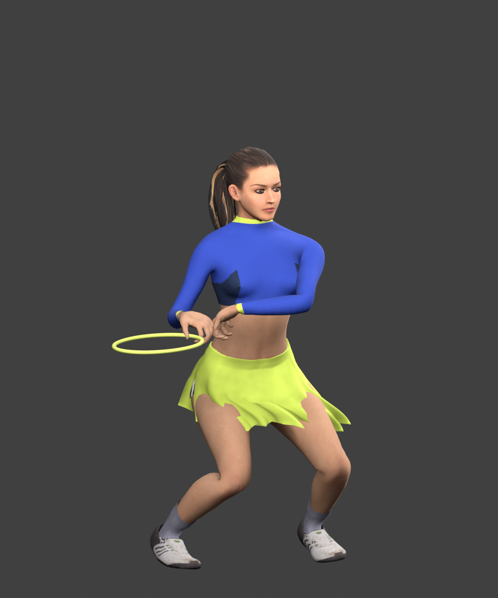
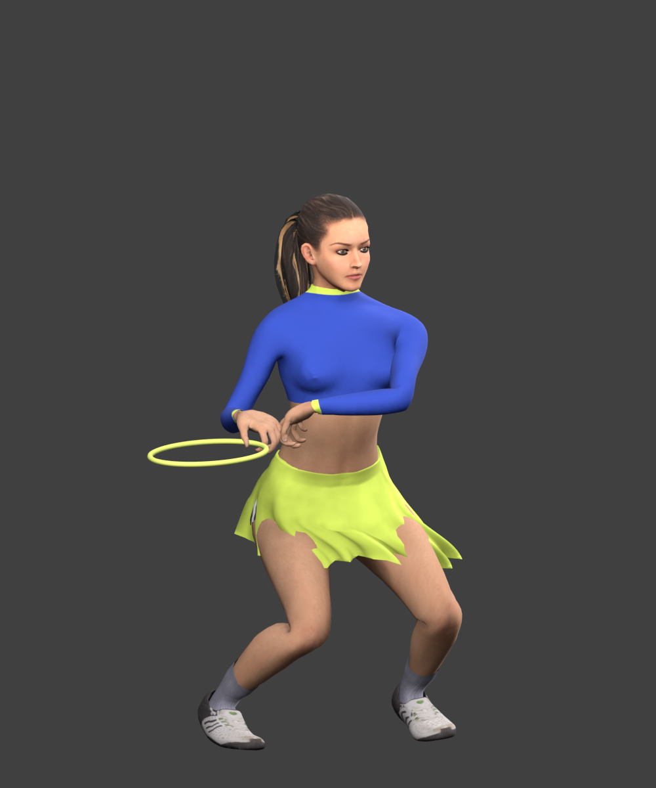

# Hero shirt palette

The dark “side” colour was placed by an atlas-space threshold that crossed the front of the fitted shirt. It looked like a blotch or a rendering defect in a close view. The native kit bake now uses a continuous blue shirt while retaining its lime collar and cuffs.

| Before | After |
| --- | --- |
|  |  |

Both views use the identical current backhand pose, camera and lighting. They are offline textured CPU-skinned comparisons, not game screenshots; runtime lighting, GPU skirt projection and rigid racket strings/shaft are omitted. The front patch is absent in the after view. Runtime visual preference is pending.

The mesh/rig asset hash is unchanged. The non-shirt atlas region retains exactly the same decoded pixels. The source bake and texture hashes match provenance, the bake compiles, and the source/public release mirrors match. A lossy re-encode changed pixels in the retained atlas region and was rejected; the lossless asset is 171,026 bytes larger with unchanged dimensions and decoded/GPU texture memory. No new motion test was needed because no motion or geometry changed.

Existing sleeve intersections and rigid-looking hair remain. This is a visual cleanup; the broader colleague-send quality bar is unproven.
