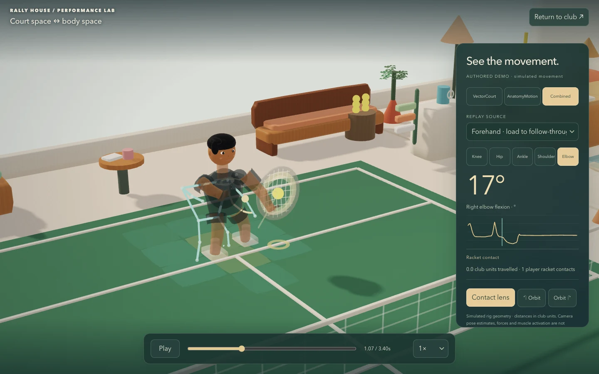
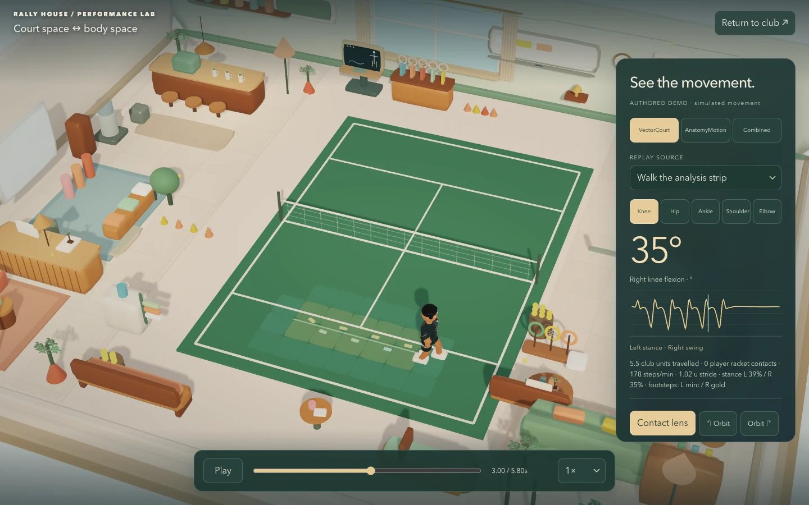
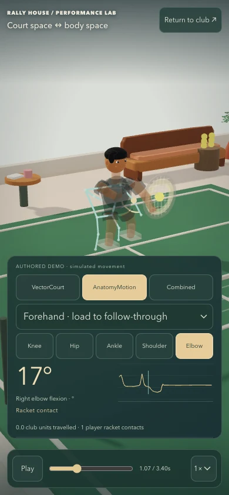

# Performance Lab release evidence — 11 October 2026

This is actual browser output and software-test evidence, not rendered concept art or a human study. Native project capability source manifests cover 103 VectorCourt and 81 AnatomyMotion first-party source/config/docs files; private footage and credentials are excluded.

* `chromium/report.json`, `firefox/report.json`, `webkit/report.json`: 24 size/mode combinations per engine, native embodied station entry, joint hit testing, controls, simulation freeze, 100 replay visits, exact camera restoration, page-cache handler/reopening and sequential frame-interval observations. No recorded page errors or failed asset responses.
* `chromium/software-backend-report.json`: preserved earlier slow software-renderer result, separate from the final Metal run.
* `release/report.json`: eight real shipped portfolio/embed layouts, no lazy iframe before entry, Axe 0, no production debug hooks, all three native lab modes and return. Its shorter initial real recording contains 36 samples.
* `release/recording.json`: separate final ordinary-RAF Championship capture, 61 samples, one authoritative player contact and one bounce, .050-unit staged-ball/contact gap, synchronized selected pose/clock.
* `impact/validation.json`: current shipped phone match, 16 held-contact exits, 12 bounded audio buffers/disposal and five final extracted-package reloads.
* `game-tests.log`: final 22-suite run, including existing gameplay/life/art and new replay invariants. Portfolio separately passed 91 tests, TypeScript, production build and lint (0 errors, 12 retained warnings).
* `generated-simulation/`: today's nondeterministic outputs, kept separately from the repository's dated historical fixtures.
* `screens/`: 102 compressed WebP copies of genuine captures, including the 72-engine matrix, portfolio/native entry, actual recorded contact and controlled A/B/C comparison. Raw source PNGs remain locally preserved. `capture-manifest.json` hashes both the originals and curated copies. Conversion changes encoding only, without upscaling, invented content or retouching.

Representative captures:

Limits and exact commands are in [RALLY-HOUSE-VALIDATION.md](../../RALLY-HOUSE-VALIDATION.md). The native projects remain experimental. Every browser metric is derived from captured game geometry and expressed accordingly; no human force, activation or diagnosis is asserted.
