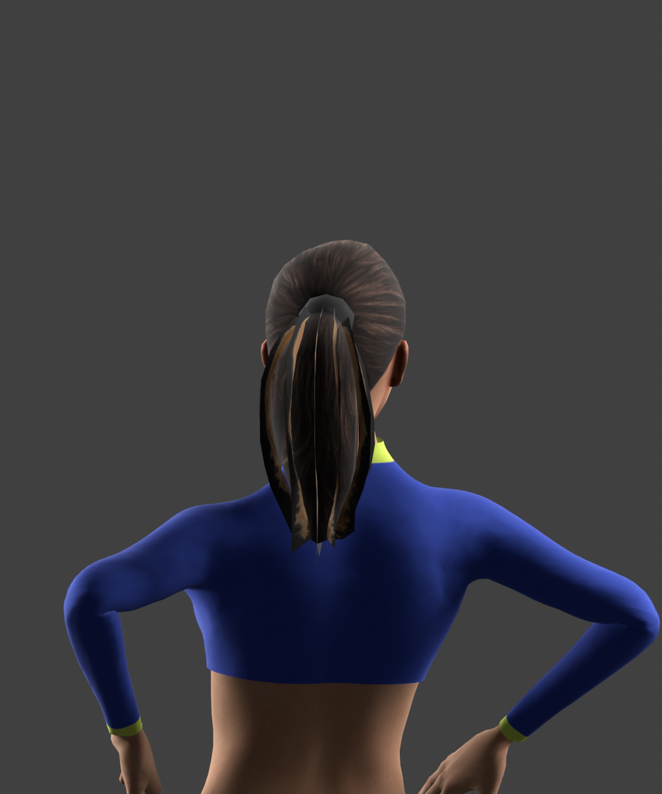
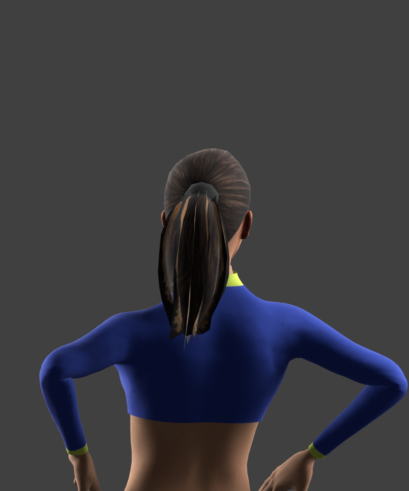

# Rejected ponytail motion experiment

Human runtime feedback: **“Too much movement or clipping.”** The candidate from `3af5246c` failed the running-game keep test. Its secondary-motion simulation, extra skin joint, hair reweighting and renderer expansion were removed, restoring the hair/runtime implementation from `0b4c4bcd`.

Approved walking, hands-on-hips, groundstroke heel pivot/recovery and the existing shoulder/clothing work remain unchanged. The independent correction to Lucresia’s stale hairstyle test remains.

| Previous hair | Rejected candidate |
| --- | --- |
|  |  |

These archived images are offline CPU-skinned renders, not game screenshots. The numerical checks below describe the rejected experiment; passing them did not establish acceptable perceptual motion. The user’s running-game feedback overrides those checks. No additional motion was added to rescue the experiment.
