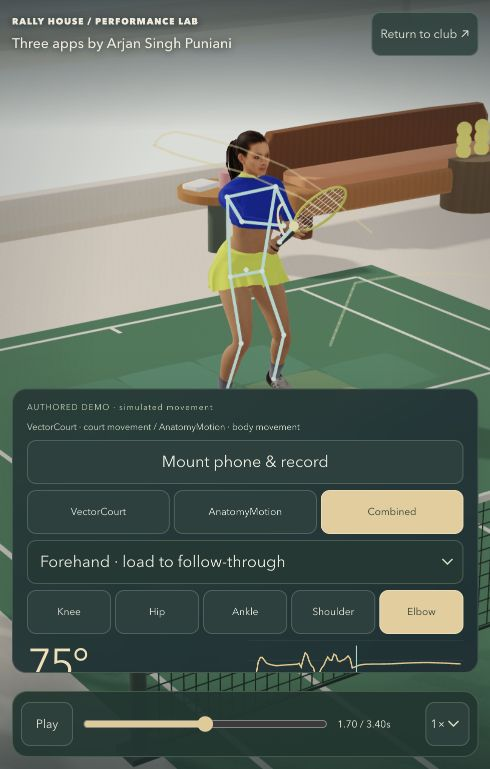
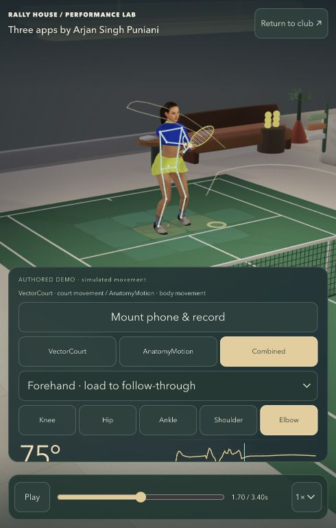

# Full-body replay framing

**Wrong:** narrow Performance Lab controls covered the hero's shoes. At 800×600, the old camera projects a gait sample to y=427 while the controls begin at y=282.

**Cause/fix:** replace the fixed narrow-view camera offset with the measured area between header and controls. Fit the complete clip's body height once per framing change, aim along camera-up, and reframe on dimension changes even when aspect ratio stays the same. Wide composition and camera restoration retain their existing behavior.

**Regression:** the new projection check fails against the preceding compiled PerformanceLab. It passes every captured walk/forehand/serve frame for generic, loaded Taylor and Arjan rigs at 490×769, 390×844 and 800×600 in body and combined views. Phone camera room clearance, replay registration and world continuity checks pass. Source/public release parity passes.

**Perceptual result:** actual Codex browser captures at 490×769 show the same forehand time, 1.70/3.40s. Both shoes now clear the controls; the entire body is smaller and readable above the panel. Club lighting and background actors changed between captures, so these are framing evidence only. No geometry, garment, pose or material improvement is claimed.

**Rejected:** no additional clothing correction was kept. Existing unsuccessful shoulder experiments remain rejected. Live actors can still overlap the replay subject; this pass does not change them.

**Colleague-send:** closer for inspection clarity; the full hero/tennis quality gate remains open, particularly the shoulder fold and garment contact.

| Before | After |
| --- | --- |
|  |  |
