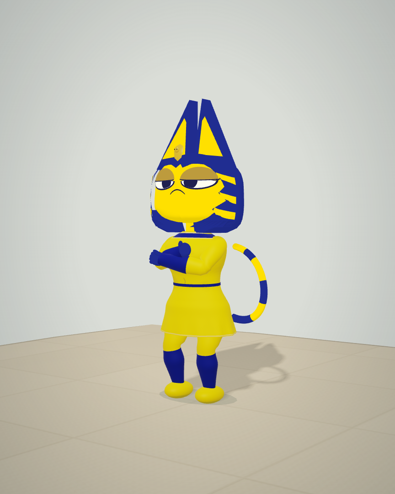
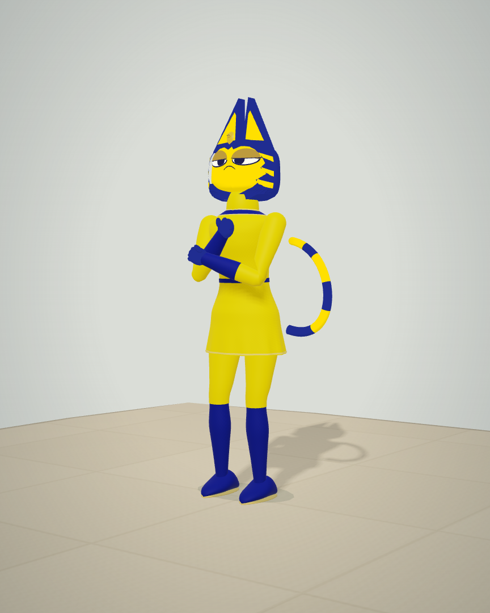

# Taylor adult body and motion

Taylor now has a taller adult athletic build, with longer leg and arm chains, a longer torso, a smaller head-to-body ratio, narrower fitted dress, smooth shoulders and contoured shoes. Her feline face, headdress and gold/indigo palette remain recognizable. This is a stylized adult character, not a clinical anatomical model or a pixel-identical photographic recreation. Private reference photos are not included.

## Actual visual comparison

These isolated images use actual `Character.meshes()` and the production renderer on an authored inspection stage. They are **not gameplay screenshots**. The baseline is commit `f6a91c2c49dda8b4e2f3cdf09bcd7a651356344b`.

| Compact baseline | Taller adult build |
| --- | --- |
|  |  |

The [front view](final-front.webp), [real Championship capture](chromium/championship.webp), [portrait club](chromium/390-club.webp), [moving replay](motion/registered-motion.webm), and [portrait review](phone-portrait/review-body.webp) show the resulting geometry in different contexts. Screenshot conversion is lossless WebP with no resize or other edits; [image-manifest.json](image-manifest.json) records source and converted SHA-256 values. Raw PNG captures remain local.

## One body, one authoritative pose

`adultTaylorPose` retargets after source animation blending and foot planting. It reconstructs knees and elbows using explicit segment lengths. Low-ball and mounted-phone reaches lower or hinge the body toward the constrained hand; they preserve world contact. The compact source pose remains the transition snapshot, so exit animations cannot be retargeted twice. The adult serve uses a 3.04-unit overhead target. Skin, recorded motion, replay and annotations all use the resulting pose.

The fitted bind surfaces are narrower, and rounded footwear is closed at its poles. The production skinned-normal shader now transforms normals correctly under nonuniform bone scale. Replay framing accounts for clip height without following every transient crouch. The courtside approach moves 0.20 units closer to its existing phone mount so the longer body reaches it naturally.

## Validation

- All **27 game suites** pass: [game-tests.log](game-tests.log). Adult chain checks inspect **43,128 limb lengths** across states and three simulation rates; maximum stretch is `1.0000000000000018`, and maximum tested hand/contact error is `1.92e-16` club units. The rendered head/body ratio, excluding ears, is approximately **6.48**.
- Independent surface checks inspect **7,560 actual emitted GPU joint pairs**, maximum error `3.82e-7` club units. Continuous reconstruction checks **3,800 intermediate poses**, maximum GPU registration error `5.17e-7`.
- Chromium, Firefox and WebKit pass native selection, desktop/portrait club views, real Championship serve contact, exit and saved-avatar reload. [Engine reports](chromium/report.json) have no runtime or HTTP errors. The observed ball/string-center gap is 0.05 club units.
- Actual moving replay covers **540 RAF frames** for both avatars across gait, forehand and serve, with exact joint-node agreement and fractional canvas picking: [motion/report.json](motion/report.json).
- A WebGL2 transform-feedback check of the actual production shader covers **27 scaled/blended normal cases**. Against independent transformed tangent geometry, maximum error falls from `1.108` in the baseline to `9.57e-8`: [skin-normals.json](skin-normals.json).
- Final portrait phone recording has **162 real pose samples**, a locally encoded video, a **7.773 ms** observed video/replay discrepancy and exact paused seek. It reports zero Axe violations, runtime/HTTP errors, overflow or remaining live tracks: [phone-portrait/report.json](phone-portrait/report.json). The complete figure lies between the collapsed video drawer and lower controls. Expanding the video overlays the scene by design.
- An intermediate portrait distance of 8 hid the head behind the drawer. Its [failed framing capture](phone-portrait-tight-framing/review-body.webp) and [partial report](phone-portrait-tight-framing/report.json) are retained. The final distance of 11 passes the explicit body bounds check.
- Full portfolio verification passes **91 tests**, TypeScript, **32 routes**, and lint with **0 errors / 12 retained warnings**: [portfolio-verify.log](portfolio-verify.log). [Portfolio entry](portfolio-entry.json) credits all three apps to Arjan Singh Puniani.
- All **70 source/served release artifacts** match. The **72-file standalone ZIP** passes CRC and exact source-byte comparison: [package.json](package.json). Five independent fresh browser starts have no errors: [standalone-diagnostic.json](standalone-diagnostic.json).

These are local automated checks, not physical-phone performance or independent human taste approval. Phone capture records the simulated scene with known motion; it does not activate a physical device camera or infer forces, muscle activation or clinical risk.

## Reproduction

From `rally-house-source-v16`, run `npm test` and `npm run release:check`. Start the source server on 8078 using `node qa/serve.mjs`. For each `QA_ENGINE=chromium`, `firefox` and `webkit`, run `QA_OUT=evidence/new-adult-check/$QA_ENGINE node qa/taylor-reference.mjs`. Run `QA_OUT=evidence/new-adult-motion node qa/replay-smoothness.mjs` and `QA_AVATAR=Taylor QA_WIDTH=390 QA_OUT=evidence/new-adult-phone node qa/phone-capture.mjs`.

For the normal comparison, export `git show f6a91c2:rally-house-source-v16/dist/rendering/Renderer.js > /tmp/body-before-renderer.js`, then run `QA_BASELINE_RENDERER=/tmp/body-before-renderer.js QA_OUT=evidence/new-adult-normals node qa/skin-normals.mjs`. Run `npm run verify` in `arjan-portfolio`. Package with `python3 qa/package-playtest.py`; serve the extracted package on 8079 with the packaged launcher's connection backlog, then run `QA_OUT=evidence/new-adult-standalone node qa/standalone-diagnostic.mjs`.
