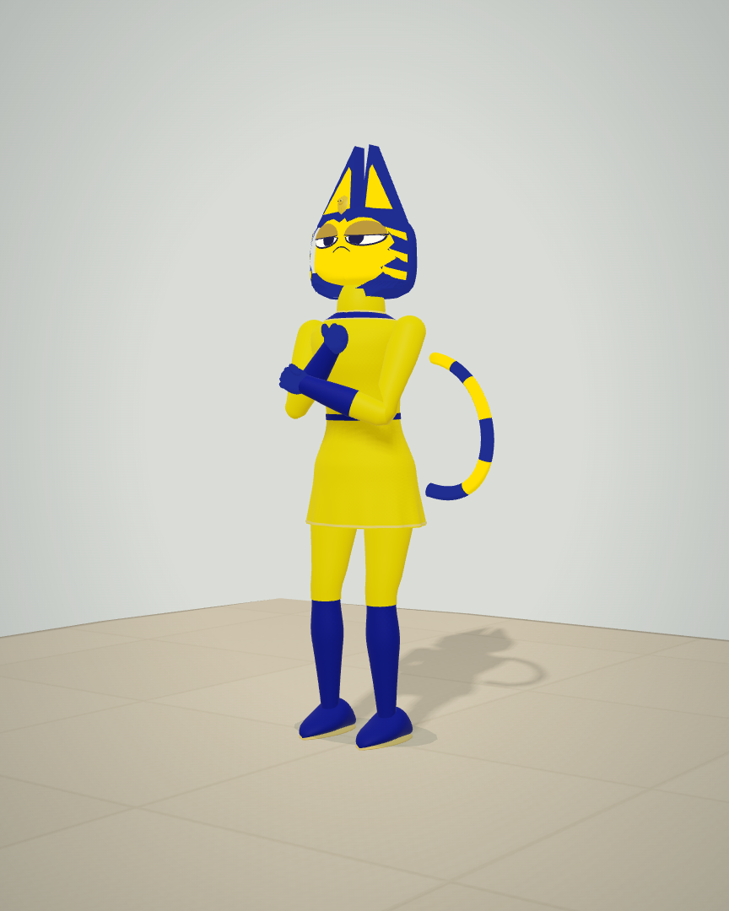
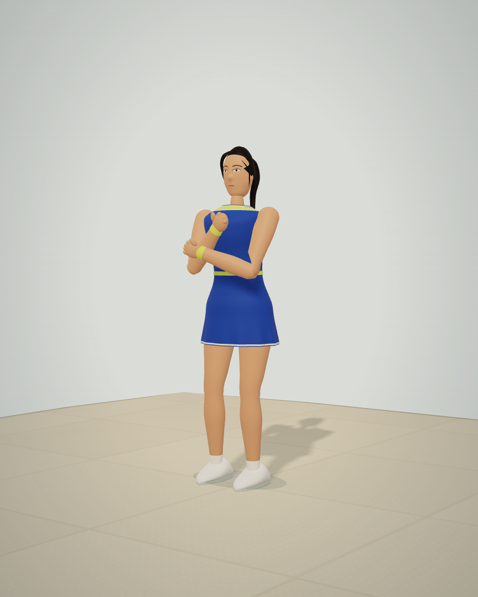

# Taylor — human tennis-player rebuild

The shipped Taylor avatar now has a fully human face and body, natural skin, a dark ponytail, a blue tennis dress, lime trim and wristbands, ankle socks and white court shoes. The face has authored jaw/cheek contours, orbital relief, a nose bridge/tip, almond eye surfaces, brows and separate lips. Blink, smile and speech act on those actual surfaces. The crown/chin are closed, and the ponytail follows smooth curves.

The references informed facial proportions and the athletic direction. This is an original stylized game character, not a photographic likeness or a claim of photorealism. Private reference photographs are not included. Legacy feline geometry remains covered by explicit historical fixture tests; it is not the default Taylor shown in the product.

## Actual visual comparison

These images use the actual character meshes and production renderer on an authored inspection stage. They are **not gameplay screenshots**. The baseline is commit `7941e3bae1db424cf5bd8e7a43fde44dc2f0ec51`.

| Previous feline avatar | Human tennis player |
| --- | --- |
|  |  |

See the [front view](final-front.webp), [face close-up](final-detail-three-quarter.webp), [real Championship](chromium/championship.webp), [portrait club](chromium/390-club.webp), [moving replay](motion/registered-motion.webm) and [portrait phone review](phone/review-body.webp). [Image hashes](image-manifest.json) record source PNG and lossless WebP SHA-256 values; conversion does not resize or edit pixels. Raw PNGs and initial iterations remain local.

## Body and motion ownership

The adult arm/leg chains, planted feet, exact racket ownership, low-ball reach and physical phone mount continue to use one authoritative pose. A 0.065-unit adjustment places the human head naturally above the shoulders and shortens the visible neck. The head attaches to the actual pose landmark; the neck connects shoulders to the jaw. Skin, dress, calves, hands, socks and wristbands all use the same bone matrices. The wristbands retain the underlying forearm's weight field. Replay records and reconstructs the same moving human body, with no substitute skeleton or invented CV result.

## Validation

- All **28 game suites** pass: [game-tests.log](game-tests.log). Human tests inspect **18,508 cached head triangles**, a closed facial surface, actual speech/lip motion and **15,840 independent eye/surface checks** through blinking. Seven animation states at 30/60/120 Hz verify head attachment and shared clothing/skin matrices.
- Adult checks still cover **43,128 limb lengths**, maximum stretch `1.0000000000000018`, and maximum tested contact error `1.92e-16` club units. The rendered head/body ratio excluding hair is approximately **6.52**. Skin-surface checks inspect **7,560 joint pairs**, maximum error `3.82e-7`; continuous reconstruction checks **3,800 intermediate poses**, maximum joint registration error `5.17e-7`.
- Chromium, Firefox and WebKit pass actual Taylor selection, desktop/portrait views, Championship serve contact, match exit and saved-avatar reload. The native test explicitly verifies a human face and absence of feline headdress/ear/tail surfaces. All three [reports](chromium/report.json) have zero runtime or HTTP failures. Observed ball/string-center gap is 0.05 club units.
- Actual moving replay passes **540 RAF frames** for both avatars across forehand, serve and gait, with zero joint-node disagreement and working fractional canvas picking: [motion/report.json](motion/report.json).
- Final portrait phone recording contains **160 real motion samples** and an **811,346-byte encoded video**. Observed video/replay discrepancy is **8.07 ms**; paused seek agrees exactly. Full body framing, owner labels, zero Axe violations, no overflow/runtime/HTTP errors and stream cleanup pass: [phone/report.json](phone/report.json).
- Full portfolio verification passes **91 tests**, TypeScript, the **32-route build**, and lint with **0 errors / 12 retained warnings**: [portfolio-verify.log](portfolio-verify.log). The real portfolio entry retains ownership labels and loads without errors: [portfolio-entry.json](portfolio-entry.json).
- All **71 source/served artifacts** match. The **73-file standalone** passes CRC and exact source-byte comparison: [package.json](package.json). Five fresh browser contexts start without runtime/network errors: [standalone-diagnostic.json](standalone-diagnostic.json).

The first full-suite run reached the new closure assertion and failed because its quantized string keys distinguished negative zero from positive zero at the numerical seam. The test now canonicalizes quantized coordinates as numbers, while still requiring every welded edge to have exactly two incident triangles. The failed [original log](game-tests-first-failure.log) and complete passing repeat are both retained. Actual crown/chin poles are explicitly closed.

These are local automated checks, not physical-device performance or independent taste approval. Phone capture encodes a simulated scene with known motion; it does not activate a device camera or infer ground reaction forces, muscle activation or clinical risk.

## Reproduction

In `rally-house-source-v16`, run `npm test` and `npm run release:check`. Serve source on 8078 with `node qa/serve.mjs`. Run `QA_ENGINE=chromium QA_OUT=evidence/new-human/chromium node qa/taylor-human.mjs`, then repeat with Firefox/WebKit. Run `QA_AVATAR=Taylor QA_WIDTH=390 QA_OUT=evidence/new-human/phone node qa/phone-capture.mjs` and `QA_OUT=evidence/new-human/motion node qa/replay-smoothness.mjs`.

For isolated renders use `QA_REFERENCE=0 QA_OUT=evidence/new-human QA_LABEL=body node qa/taylor-proportions.mjs`; add `QA_DETAIL=1` for the face close-up. The baseline comparison uses a complete immutable `dist` snapshot supplied through `QA_BASELINE_RUNTIME`. Run `npm run verify` in `arjan-portfolio`. Package with `python3 qa/package-playtest.py`, serve its extracted runtime on 8079 with the packaged launcher's connection backlog, and run `QA_OUT=evidence/new-human node qa/standalone-diagnostic.mjs`.
