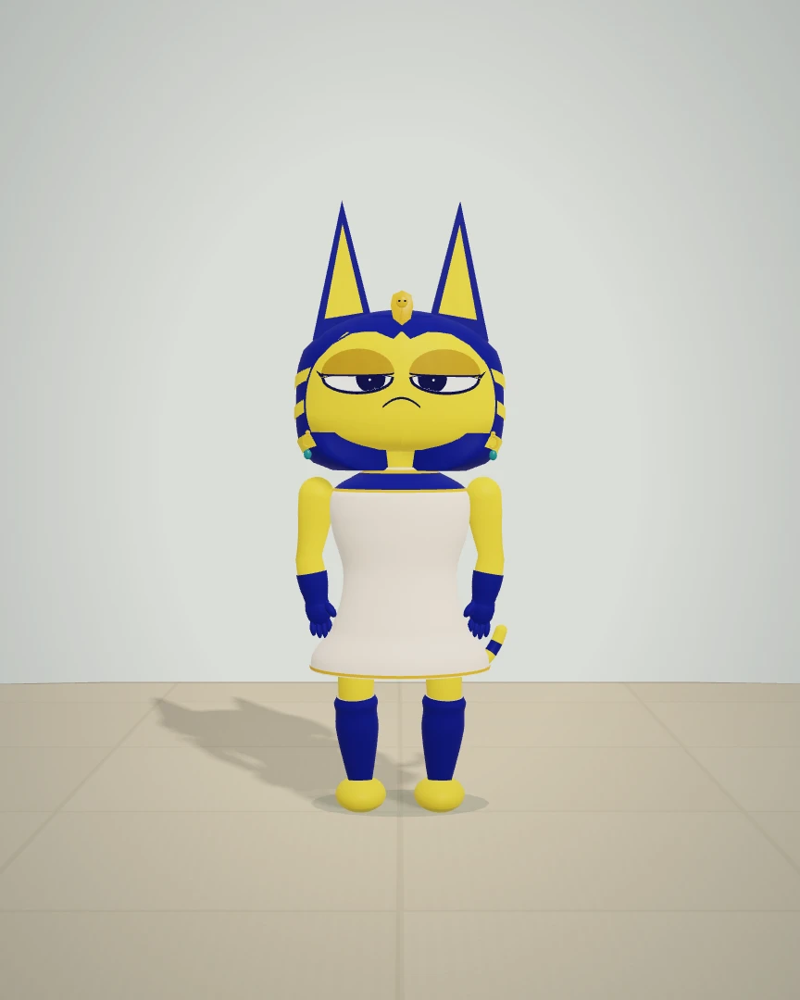
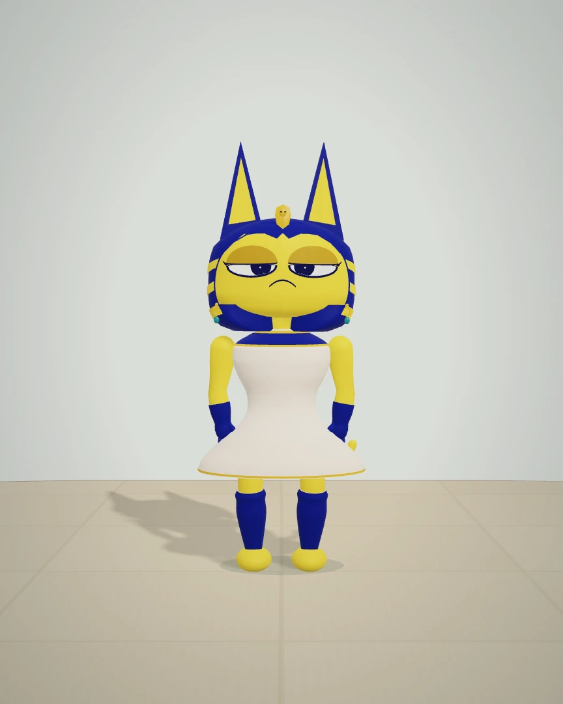

# Taylor silhouette refinement — October 11, 2026

The reference crop shows a strong contrast between the head, narrow waist and broad lower silhouette. This pass adjusts Taylor’s continuous dress contour: waist radius .245 → .207, upper hip .302 → .390, and hem .389 → .515 club units. The gold hem follows the same surface profile. Head, ears, face, limb lengths, anatomical joint positions, skin weights and Championship solver are unchanged. Geometry identifiers advance so the renderer cannot retain the previous mesh.

This is a closer costume silhouette, not an exact recreation of the reference pose or outfit. The reference does not establish full leg proportions. No new limb dimensions were inferred from its crop.

## Actual before / after

Both images use the actual game Character meshes, production renderer, identical idle pose, camera and lighting on an authored inspection stage. They are not gameplay screenshots. The before render substitutes only the prior dress and edging from commit 67ea372; all other geometry is identical. Three-quarter captures are also included. Capture source hashes are in capture-manifest.json; untouched PNG originals remain local. The initial before captures with UI overlays remain local and were superseded by clean renders.

## Validation

- All 24 game suites pass, including Taylor appearance, geometry, contact recovery, rig registration and continuous replay. Registration covers 324 actual GPU surface samples, 1,006 overlays and 3,800 intermediate poses for both avatars; maximum GPU joint error remains below 0.0000005 club units.
- Actual moving browser replay checks 540 RAF frames across both avatars and all three demonstrations. Measurements and plot cursor match the rendered pose; all joint nodes have zero disagreement with their authoritative positions. Fractional joint picking passes. An unedited playback video accompanies the report.
- Seven actual registered-rig captures cover both avatars in walking, forehand and serve, including Taylor at 390×844. No page errors.
- Portfolio: all 91 tests and TypeScript pass; lint has zero errors and 12 retained warnings. Source and served runtimes match across all 68 release artifacts.
- Standalone: 70 files, approximately 224 KiB; ZIP CRC verified. Five independent uncached startups pass with no console, HTTP or request failures.
- Geometry sampling and triangle budgets remain unchanged. Earlier cross-engine and production-build evidence remains in the continuous-replay evidence folder; this geometry pass does not establish new cross-engine FPS or physical-phone measurements.

Fresh nondeterministic simulation reports are preserved under generated-simulation; historical fixtures retain their original bytes.

## Reproduce

Serve the compiled game on 8078 and the extracted standalone on 8079 using its packaged launcher configuration. Run npm test and npm run release:check, then QA_OUT=evidence/taylor-proportions-20261011/avatars node qa/rig-registration.mjs and QA_OUT=evidence/taylor-proportions-20261011/motion node qa/replay-smoothness.mjs. node qa/taylor-proportions.mjs captures the current portrait. For the clean baseline, export git show 67ea372:rally-house-source-v16/dist/animation/CharacterSkin.js to a temporary file and set QA_LABEL=before and QA_BASELINE to that path. The baseline module is used in the inspection harness only.
