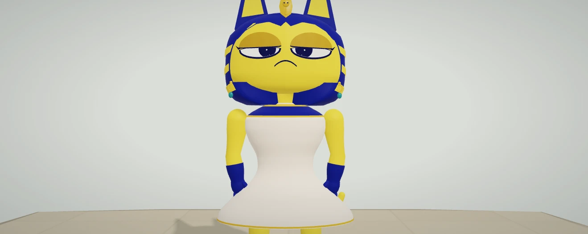
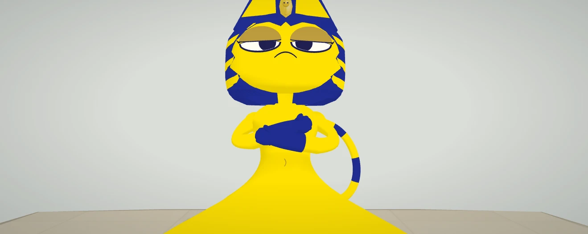

# Taylor reference likeness rebuild — October 11, 2026

The previous pass reshaped a white dress. This pass addresses the visible character identity: inward-pointing tall ears, higher-set half-lidded eyes and skeptical mouth, a zigzag cheek frame with three clean gold bands on each side, a folded-paw resting stance, an upright striped tail, and a continuous gold tunic with a narrow waist and broad lower silhouette. Extraneous earrings, white fabric, indigo neckline and collar jewellery have been removed. A restrained cel-shading material preserves the saturated gold/indigo palette; the club and human avatars retain their existing materials.

This is manually authored, animated 3D game geometry. It is a closer recreation of the visible character, not a pixel-identical copy of the flat reference or its Egyptian background. Full-body tunic/leg design below the crop remains authored interpretation.

## Actual before and after

The clean comparison uses the same 1319×526 viewport, camera, lighting and inspection stage. Before uses the complete relevant runtime modules from commit 57065a2 through a local browser route; after uses the current actual Character meshes and production Renderer. The stage is authored inspection, not a gameplay screenshot. Three-quarter views are also included. Actual club and Championship screenshots appear under chromium, firefox and webkit. Curated WebP copies have source PNG hashes in capture-manifest.json; original PNGs remain untouched locally. No reference pixels, AI image or painted-over screenshots were used to manufacture the result.

## Motion and registration

The folded stance is part of the authoritative Character pose, so skin, capture, replay, measurements and overlay see the same shoulder/elbow/hand landmarks. It is available with a stowed racket at unoccupied club idle and releases immediately for matches, props, reaches and social gestures. Native selection, activity release and saved-avatar reload restore its availability. Tennis hand/foot/contact trajectories remain unchanged.

Paw bones remain rigid when the forearm changes length, fixing stretched fingers without moving the contact joints. The upright tail uses a consistent frame along its planar curve so the frame cannot flip at the vertical tangent. Gold headdress bands are clipped against actual cheek triangles and share their surface depth. The embroidered crescent shares the tunic's skinning weights.

## Validation

- All 24 game suites pass. Taylor geometry checks include normals/winding, pupil containment, attachment to the actual face, bounded tail and the unchanged gameplay rig at 30/60/120 Hz. New checks verify authoritative folded-pose GPU hand anchors at three rotations and update rates, rigid paw volumes and immediate match release. Every gold-band vertex and triangle centre lies within .010 units of actual headdress fabric; maximum observed gap .004870 units. The head remains within its existing 12,500-triangle budget (12,304 actual triangles; largest part 3,360).
- Registration tests inspect 324 GPU surface samples and 1,006 overlays; 3,800 intermediate poses cover both avatars across gait/serve/forehand. Maximum GPU joint error remains below 0.0000005 club units.
- Real moving browser replay checks 540 RAF frames, current readout/plot cursor, exact joint-node agreement and fractional joint picking. The unedited video is included.
- Chromium, Firefox and WebKit each pass native Taylor selection, 1440×900 and 390×844 actual club rendering, registered folded pose, Championship entry/real serve contact, exit and saved-avatar reload. All final console/page and HTTP error lists are empty. Contact error is .050 simulated club units in each engine.
- A first Firefox reload caught an unhandled audio-close rejection. The original log/report are retained. Audio resume and teardown now handle expected browser rejections; a regression test checks rejected resume/close without an unhandled promise or retained context. Firefox repeat passes without filtering the error.
- Portfolio verification passes: lint (zero errors / 12 retained warnings), TypeScript, all 91 tests with coverage, and production build (32 routes). Final lint passes again after the audio fix. Source/served runtime matches all 68 release artifacts.
- Standalone ZIP: 70 files, approximately 225 KiB; CRC and exact compiled-runtime bytes verified. Five independent fresh-context startups pass without console, HTTP or request failures.

Earlier geometry iteration failures are retained separately; their raw portraits remain local. Fresh nondeterministic simulation reports are under generated-simulation; historical fixtures preserve their prior bytes. These are functional checks, not new physical-phone or universal frame-rate measurements. Earlier Firefox performance limitations remain open.

## Reproduce

Serve source on 8078 and the extracted package on 8079 with the packaged launcher's connection queue. Run npm test and npm run release:check. node qa/taylor-proportions.mjs captures the reference-framed portrait; QA_REFERENCE=0 captures a full portrait. For the same-framing baseline, export the changed dist modules from commit 57065a2 into a temporary directory and pass its path as QA_BASELINE_RUNTIME with QA_LABEL=before. The substituted modules are Game.js, animation/CharacterSkin.js, animation/TaylorAppearance.js, content/PlayerAvatars.js, entities/Character.js and rendering/Renderer.js.

Run node qa/taylor-reference.mjs, QA_ENGINE=firefox node qa/taylor-reference.mjs and QA_ENGINE=webkit node qa/taylor-reference.mjs for native checks. QA_OUT=evidence/taylor-reference-20261011/motion node qa/replay-smoothness.mjs captures moving replay. WEBKIT_EXECUTABLE can select the installed WebKit runtime. Full portfolio validation uses npm run verify from arjan-portfolio.
