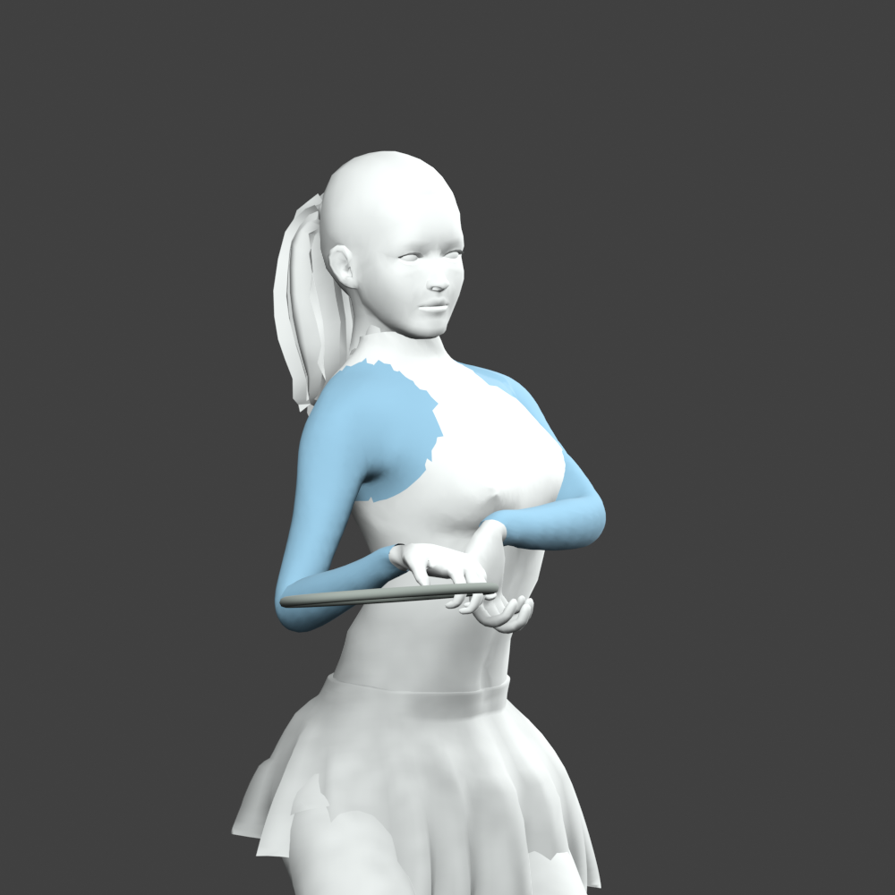
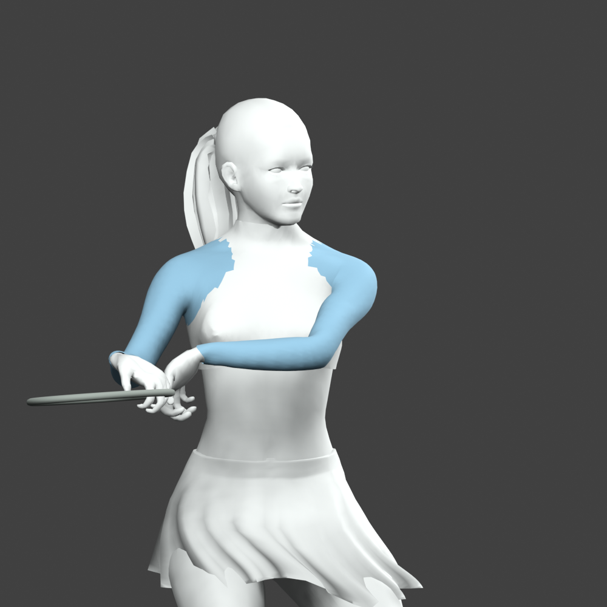
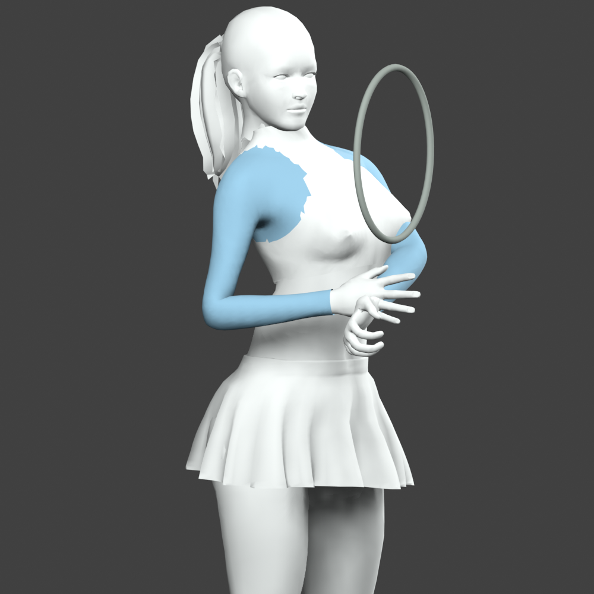
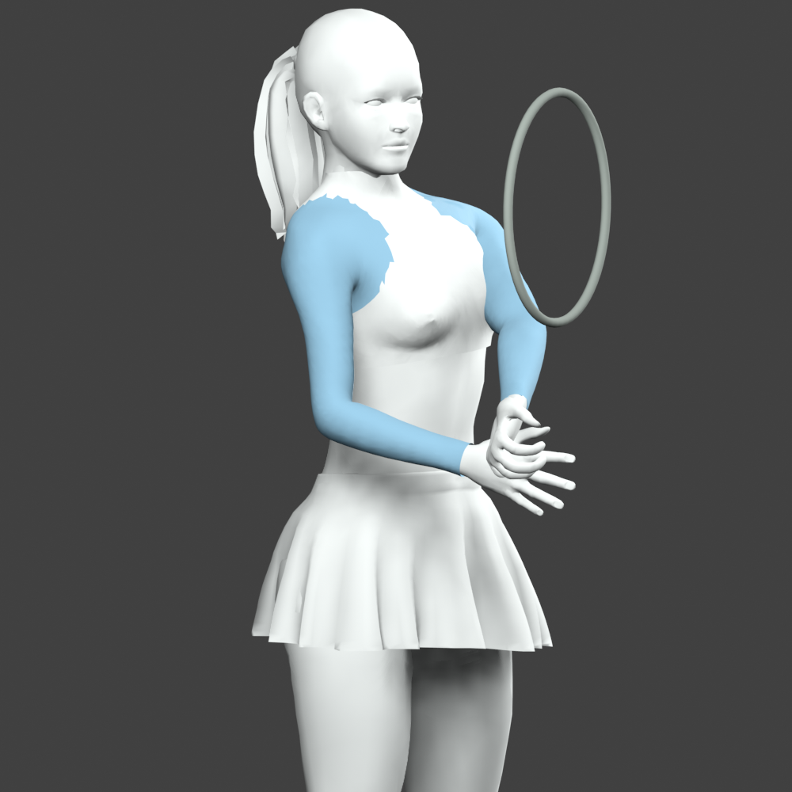

# Shoulder and sleeve correction

The previous solver measured the forearm to the palm grip while skinning ended it at the wrist. This stretched the visible forearm during strokes. Shoulder reach also dragged the chest, and the forehand/backhand load turn was reversed. The shared solver now uses the authored wrist while preserving grip authority, anchors the chest before shoulder reach, and turns the hitting shoulder correctly. The tossing arm returns toward its existing neutral pose during serve recovery.

The user tested a backhand and serve in the running game and reported **“More natural, less clipping.”** The approved club rest/walk landmarks and skin palettes match the baseline exactly. The existing hands-on-hips targets are unchanged.

## Comparison

| Phase | Before | After |
| --- | --- | --- |
| Backhand load, 0.10 s |  |  |
| Serve recovery, 0.70 s |  |  |

**These are offline geometry diagnostics, not game screenshots.** They use the actual CPU-skinned project meshes, identical camera and simplified materials; sleeve-weight regions are blue. Textures, runtime lighting, GPU skirt flutter and rigid racket shaft/strings are omitted. They show deformation differences, not final game appearance or performance.

Build, authored-athlete/contact, anatomical arm, approved gait, garment deformation, jersey intersection, replay, phone capture, Performance Lab and release mirror checks pass. The wrist regression detects stretching on the previous runtime. The focused jersey test covers ready and forehand recovery across the four women at 30/60/120 Hz; it excludes adjacent local folds and cannot certify all motion collision-free.

Rejected: moving elbow guides, increasing hand clearance, reducing shoulder reach and extra weight smoothing traded one intersection for another or worsened creasing. No mesh replacement or new animation framework was added.

Loaded backhands and serve recovery still have sleeve/torso intersections. No fresh agent live visual or device frame-time check was possible. This remains a draft; the broader colleague-send quality bar is unproven.
